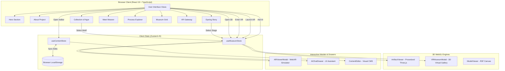
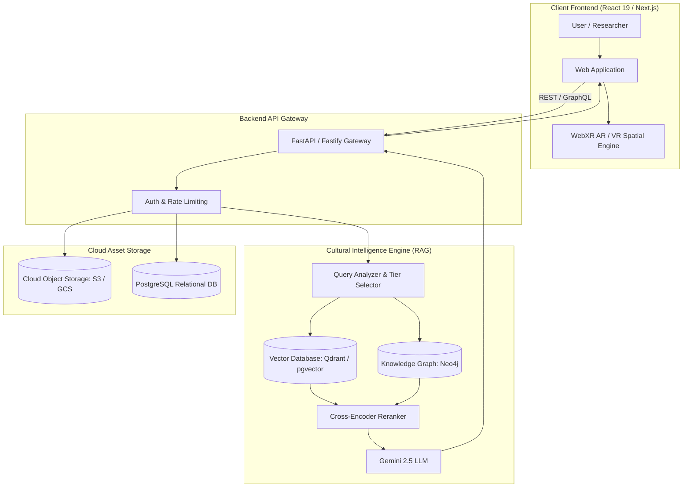

# Project Overview: Bodo Handloom Cultural Heritage Digital Platform

> **Document Status**: Authoritative Engineering Architecture, System Specification, and Academic Defense Document  
> **Repository Name**: `bodo-handloom-museum`  
> **Target Audience**: Software Architects, Academic Evaluators, Final-Year CSE Project Reviewers, and Onboarding Engineers  

---

## 1. Project Overview

### Project Name
**Bodo Handloom Cultural Heritage Digital Platform & VR Museum**  
*(Codebase identifier: `bodo-handloom-museum` / `bodo-handloom-museum-frontend`)*

### Project Purpose
The project is a specialized, web-based digital cultural repository and immersive virtual museum dedicated to preserving, cataloging, and celebrating the indigenous handloom craftsmanship, sacred geometric *Agor* motifs, Ahimsa Eri silk lineage, natural botanical dyeing formulations, and living oral histories of the Bodo indigenous community of Bodoland and Assam, Northeast India.

### Problem Being Solved
1. **At-Risk Indigenous Knowledge**: The indigenous weaving practices, botanical dye chemistry, and motif grammar of the Bodos have historically been transferred orally from grandmother to granddaughter on open homestead verandas. Rapid industrialization and synthetic commercial textile flooding threaten the survival of these nuanced techniques.
2. **Lack of Standardized Digital Documentation**: Existing academic and anthropological studies on Bodo textiles remain largely locked in regional print books or fragmented field notes without accessible, structured digital representations.
3. **Absence of Interactive Cultural Archives**: Most tribal heritage exhibitions are static 2D museum showcases. Young generations, researchers, and global textiles enthusiasts lack interactive mechanisms to inspect loom kinematics, trace thread processing stages, test motif meanings, or experience immersive cultural spaces.
4. **Need for a Decoupled, Frontend-First Architectural Foundation**: Preserving living heritage requires an agile, data-driven editorial system where field researchers can update documented stages, replace high-resolution field photography, and catalog artifacts locally prior to connecting heavy cloud backends and AI pipelines.

### Why Bodo Handloom Heritage Needs Digital Preservation
- **Cultural Identity**: Textiles like the *Dokhona Thaosi* (women's traditional dress) and *Aronai* (ceremonial scarf of honor) are quintessential emblems of dignity, pride, and social harmony in Bodoland.
- **Ecological Wisdom**: Bodo weaving relies on *Ahimsa Eri silk* (peace silk where the silkworm pupa emerges naturally without boiling the pupa alive) and ancestral organic dyes (turmeric, madder root, wild indigo, fitkaari/alum mordants).
- **Geometric Mathematics**: The *Agor* motifs are sophisticated mathematical extra-weft arrangements derived from natural topography (*Hajw* - mountain ridges), flora (*Dingkhia* - wild fern fiddleheads, *Thaigir Bibar* - elephant apple blossom), and fauna (*Daorai* - dancing peacock plumes, *Muphur Apha* - bear footprints).

### Target Users
- **Cultural Enthusiasts & General Public**: Discover the aesthetic beauty and cultural stories behind Bodo textiles.
- **Textile & Ethnographic Researchers**: Access verified botanical dye workflows, tools nomenclature, and field oral histories.
- **Bodo Community & Next-Generation Youth**: Connect with their ancestral heritage through modern 3D WebGL, interactive stories, and mobile-friendly interfaces.
- **Museum Curators & Content Administrators**: Utilize the in-browser visual Content Editor and Document Extraction system to update archives without modifying source code.

### Main Objectives
1. Build a high-performance, responsive, culturally grounded web interface showcasing Bodo textile heritage.
2. Provide interactive modules for **Motif Inspection**, **Botanical Dyeing Journeys**, **Handloom Process Timelines**, and **Master Weaver Profiles**.
3. Establish procedural and WebGL 3D inspection components for traditional loom implements (*Maku* shuttle, *Sal* loom, *Khabang* winder).
4. Lay the strict architectural contracts for future **WebXR AR/VR**, **Retrieval-Augmented Generation (RAG)**, and **Knowledge Graph** integrations.

### Current Development Stage
- **Stage**: **Frontend-First Production Prototype with In-Browser Visual CMS & WebGL 3D/VR Gateways**.
- The entire user interface, data registries, interactive modal experiences, Three.js 3D viewers, and content editor are fully operational in the client application.
- Server-side REST APIs, vector databases, and neural models are clearly demarcated for subsequent integration phases.

### Major Features (Current Implementation)
- **Living Hero & Cultural Inscriptions**: Typography hierarchy featuring Merriweather, Cormorant Garamond, and Plus Jakarta Sans.
- **Collection of Agor (Motif Matrix)**: 1-to-1 synchronized motif viewer connecting each pattern to its authentic meaning, symbolism, local Bodo name, and textile association.
- **Interactive Dyeing Process Module**: 5-stage documented dyeing story featuring boiling, mordanting, dye extraction, filtering, simmering, and shade curing, accompanied by a dynamic administrative document uploader.
- **Oral Heritage & Weaver Archive**: Master artisan biography, recorded field interview audio player, and preserved masterpieces gallery.
- **Handloom Process Explorer**: 9-stage sequence (*Ginning* $\rightarrow$ *Spinning* $\rightarrow$ *Reeling* $\rightarrow$ *Sizing* $\rightarrow$ *Winding* $\rightarrow$ *Warping* $\rightarrow$ *Beaming* $\rightarrow$ *Looming* $\rightarrow$ *Weaving*).
- **Digital Artifacts Catalog**: Filterable museum inventory with category filters, keyword search, and accession cards.
- **In-Browser Content Editor (`/editor`)**: Visual CMS with client-side canvas image optimization, local storage persistence, and JSON export/import.
- **3D Artifact Viewer & VR Museum Space**: WebGL-powered 3D asset inspection with custom procedural geometry and a walkable 6-zone virtual gallery.

### Future Vision
A fully connected, cloud-native **Cultural Intelligence Engine** pairing a WebXR spatial museum with an academic RAG pipeline grounded on indigenous oral recordings and historical research manuscripts.

---

## 2. Current System vs Future System

| Feature | Status | Evidence / Location | Future Plan |
|---|---|---|---|
| **Frontend Application** | **CURRENTLY IMPLEMENTED** | `frontend/src/App.tsx`, `frontend/src/main.tsx` | Next.js server-side rendering (SSR) for advanced indexing |
| **Heritage & Hero Section** | **CURRENTLY IMPLEMENTED** | `frontend/src/components/Hero.tsx` | Dynamic hero video streaming and seasonal festival banners |
| **About Project Section** | **CURRENTLY IMPLEMENTED** | `frontend/src/components/AboutSection.tsx` | Community submission portal for village weaving guilds |
| **Collection of Agor** | **CURRENTLY IMPLEMENTED** | `frontend/src/components/MotifCollection.tsx`, `frontend/src/data/motifs.ts` | 3D motif pattern tessellation and generative pattern synthesis |
| **Collection of Dyeing** | **CURRENTLY IMPLEMENTED** | `frontend/src/components/DyeingSection.tsx`, `frontend/src/data/dyeing.ts` | Chemical formula spectra and temperature sensor telemetry integration |
| **Meet the Weaver Section** | **CURRENTLY IMPLEMENTED** | `frontend/src/components/WeaverSection.tsx`, `frontend/src/data/weavers.ts` | Video oral histories with synchronized bilingual transcript subtitles |
| **In-Browser Image CMS** | **CURRENTLY IMPLEMENTED** | `frontend/src/components/ContentEditor.tsx`, `frontend/src/utils/imageOptimizer.ts` | Cloud object storage (S3 / Google Cloud Storage) with CDN delivery |
| **3D Procedural Models** | **CURRENTLY IMPLEMENTED** | `frontend/src/components/3d/ArtifactViewer.tsx` (Three.js WebGL) | Photogrammetry high-poly assets with level-of-detail (LOD) |
| **Physical GLB/GLTF Loading** | **PARTIALLY IMPLEMENTED** | `frontend/src/components/three/ModelViewer.tsx` (R3F Canvas ready, waiting for assets) | Deposit optimized Draco-compressed GLB files in `public/assets/models/` |
| **Augmented Reality (AR)** | **PARTIALLY IMPLEMENTED** | `frontend/src/components/3d/ARViewerModal.tsx` (WebXR session check + reticle simulator) | Full WebXR camera hit-test with environmental plane detection on Android/iOS |
| **Virtual Reality (VR)** | **CURRENTLY IMPLEMENTED (WebGL)** | `frontend/src/components/3d/VRMuseumModal.tsx` (Three.js 6-zone virtual gallery) | WebXR immersive-vr headset support (Oculus/Meta Quest, Apple Vision Pro) |
| **Backend Server** | **PLANNED / FUTURE** | `frontend/src/services/api.ts` (Explicit architectural stub) | Fastify / Express / NestJS microservice running Node.js / Python |
| **Persistent Database** | **PLANNED / FUTURE** | Currently stored in browser `localStorage` (`contentStore.ts`) | PostgreSQL (relational catalog) + Neo4j (Cultural Knowledge Graph) |
| **AI Assistant Interface** | **CURRENTLY IMPLEMENTED (UI Only)** | `frontend/src/components/AIChatDrawer.tsx`, `frontend/src/components/ai/` | Full neural response generation via LLM gateway |
| **Retrieval-Augmented Gen (RAG)** | **PLANNED / FUTURE** | Architecture defined in documentation; mocked in UI | Pinecone / Qdrant / pgvector embedding store of Bodo manuscripts |
| **Knowledge Graph** | **PLANNED / FUTURE** | Semantic relationships modeled in TypeScript interfaces | Neo4j / RDF triplestore connecting weavers, motifs, and botany |
| **REST / GraphQL API** | **PLANNED / FUTURE** | `frontend/src/services/api.ts` | OpenAPI-compliant REST endpoints and GraphQL schema |

---

## 3. Complete Technology Stack

| Category | Technology | Version | Purpose | Where Used |
|---|---|---|---|---|
| **Language** | TypeScript | `^7.0.2` | Strong type checking, interface contracts, compile-time safety | Entire `frontend/src` codebase |
| **Runtime Environment** | Node.js | v20+ / bun | JavaScript runtime and execution environment | Workspace build and development scripts |
| **Frontend Framework** | React | `^19.0.1` | Component-driven reactive UI architecture | Entire component hierarchy |
| **DOM Renderer** | React DOM | `^19.0.1` | Reconciliation and DOM rendering | `frontend/src/main.tsx` |
| **Build Tool & Bundler** | Vite | `^8.3.0` | Ultra-fast ES-module bundling, dev server, and asset optimization | `frontend/vite.config.ts` |
| **Styling Engine** | Tailwind CSS | `^4.3.3` | Utility-first responsive CSS styling | `frontend/src/index.css`, `@tailwindcss/vite` |
| **Vite Tailwind Plugin** | `@tailwindcss/vite` | `^4.3.3` | Native compilation of Tailwind CSS in Vite | `frontend/vite.config.ts` |
| **Motion & Animation** | Motion (Framer Motion) | `^12.23.24` | Layout transitions, spring physics, drawer slide-ins, fade animations | `Hero.tsx`, `AIChatDrawer.tsx`, `Modal.tsx` |
| **Iconography** | Lucide React | `^0.546.0` | Clean, culturally neutral SVG vector icons | Used across all UI components |
| **State Management** | Zustand | `^5.0.15` | Lightweight reactive store for modal, museum, and CMS state | `museumStore.ts`, `contentStore.ts` |
| **3D Rendering Core** | Three.js | `^0.186.1` | WebGL scene graph, perspective camera, lights, materials, rendering | `ArtifactViewer.tsx`, `VRMuseumModal.tsx` |
| **React 3D Canvas** | `@react-three/fiber` | `^9.8.1` | Declarative React wrapper around Three.js | `ModelViewer.tsx` |
| **Three.js Helpers** | `@react-three/drei` | `^10.7.9` | Camera controls, environment staging, GLTF loader hooks | `ModelViewer.tsx` |
| **WebXR Spatial Library** | `@react-three/xr` | `^6.6.31` | Spatial WebXR controllers, AR hit-testing, VR entry | Prepared for spatial upgrades |
| **AI SDK (Prepared)** | `@google/genai` | `^2.4.0` | Google Gen AI TypeScript SDK for Gemini API integration | Prepared in dependencies for backend |
| **Server Engine (Prepared)**| Express | `^4.21.2` | HTTP web server | Root dev scripts & future backend |
| **Development Execution** | TSX & Esbuild | `^4.21.0` / `^0.25.0`| Fast TypeScript execution and compilation | Scripts and build toolchain |

---

## 4. Technology Deep Dive

### 1. React 19 (`react` & `react-dom` v19.0.1)
- **What it is**: The modern version of Meta's open-source declarative UI library.
- **Why it is used**: Provides component modularity, hooks (`useState`, `useEffect`, `useRef`, `useMemo`), fast virtual DOM reconciliation, and seamless concurrent rendering.
- **Where it is used**: Powers every visual block in `frontend/src/components/`, from section cards to full-screen modals.
- **How it works here**: Orchestrates the rendering pipeline, passes typed props, handles user events, and mounts Three.js canvases safely into DOM nodes using `useRef`.
- **Suitability**: Cultural heritage applications require rapid updates, reactive state syncing, and high modularity across dozens of interrelated artifact categories.

### 2. Vite 8 (`vite` v8.3.0 & `@vitejs/plugin-react` v6.1.1)
- **What it is**: Next-generation frontend build tool created by Evan You.
- **Why it is used**: Replaces legacy Webpack with native ES module imports during development, offering near-instant cold server start and blazing-fast Rollup-based production builds.
- **Where it is used**: Configured in `frontend/vite.config.ts`; executes dev servers on port 3000 and generates production bundles in `dist/`.
- **How it works here**: Directly processes TypeScript and `@tailwindcss/vite`, hot-replaces CSS, and bundles Three.js geometries into optimized chunks.
- **Suitability**: Essential for quick design iteration and immediate previewing of high-resolution cultural assets.

### 3. Tailwind CSS v4 (`tailwindcss` & `@tailwindcss/vite` v4.3.3)
- **What it is**: Modern utility-first CSS framework natively compiled without heavy PostCSS pipelines.
- **Why it is used**: Enables rapid, uniform styling using semantic utility classes without writing disconnected `.css` files.
- **Where it is used**: Styled throughout all JSX elements; imported via `@import "tailwindcss";` in `frontend/src/index.css`.
- **How it works here**: Interacts seamlessly with custom CSS variables in `frontend/src/styles/fonts.css` and `frontend/src/styles/animations.css`.
- **Suitability**: Consistent spacing (`p-4`, `max-w-7xl`), responsive breakpoints (`sm:`, `md:`, `lg:`), and custom cultural colors (`#8B1E3F` madder red, `#FFE600` turmeric yellow, `#FAF8F5` cream cloth background).

### 4. Zustand v5 (`zustand` v5.0.15)
- **What it is**: Minimalist, unopinionated client state management library built on React hooks.
- **Why it is used**: Avoids Context API re-render cascades and Redux boilerplate while providing clean global stores accessible outside the React component tree.
- **Where it is used**: Implemented in `frontend/src/store/museumStore.ts` and `frontend/src/store/contentStore.ts`.
- **How it works here**: Provides reactive getters/setters and local storage persistence (`localStorage.getItem('bodo_vr_museum_content_v2')`).
- **Suitability**: Ideal for coordinating multi-modal interfaces where opening an AR modal or selecting an Agor motif must instantly notify the 3D viewer, search index, and AI context banner.

### 5. Three.js (`three` v0.186.1)
- **What it is**: Industry-standard WebGL 3D JavaScript library.
- **Why it is used**: Renders interactive 3D objects, lighting, cameras, and textures directly in HTML5 canvas elements without requiring external browser plugins.
- **Where it is used**: `frontend/src/components/3d/ArtifactViewer.tsx` and `frontend/src/components/3d/VRMuseumModal.tsx`.
- **How it works here**: Builds custom geometric primitives representing traditional Bodo implements (tapered bamboo *Maku* boat shuttles, reed bobbins, timber frames) and renders a virtual 6-zone museum hall with directional illumination and soft shadow maps.
- **Suitability**: Crucial for indigenous preservation where users need to rotate, tilt, and examine the physical mechanics of traditional weaving tools in 360 degrees.

### 6. React Three Fiber (`@react-three/fiber` v9.8.1) & Drei (`@react-three/drei` v10.7.9)
- **What it is**: A declarative React renderer for Three.js accompanied by a rich ecosystem of camera, control, and asset helpers.
- **Why it is used**: Allows treating 3D scene elements as native React components (`<Canvas>`, `<OrbitControls>`, `<Environment>`).
- **Where it is used**: `frontend/src/components/three/ModelViewer.tsx`.
- **How it works here**: Manages GLTF loading via `useGLTF`, handles async asset streaming with React Suspense, and provides orbit controls with damping.
- **Suitability**: Simplifies future loading of photogrammetric `.glb` files captured from real museum artifacts.

### 7. Motion (`motion` v12.23.24)
- **What it is**: Modern iteration of Framer Motion for React.
- **Why it is used**: Provides declarative layout animations, spring curves, and exit animations using `<AnimatePresence>`.
- **Where it is used**: Slide-out panels (`AIChatDrawer.tsx`), fade/zoom modals (`ARViewerModal.tsx`, `HeroPhotoModal.tsx`), and smooth state transitions.
- **How it works here**: Intercepts DOM unmounting to execute smooth visual exits when closing drawers or switching motifs.
- **Suitability**: Delivers a polished, editorial, museum-grade aesthetic with graceful motion.

---

## 5. Complete Project Pipeline

```text
USER / BROWSER CLIENT
       │
       ▼
[ index.html Entry Point ]
       │  - Loads Google Web Fonts (Merriweather, Cormorant Garamond, Plus Jakarta Sans)
       │  - Mounts root DOM container (#root)
       ▼
[ main.tsx React Bootstrap ]
       │  - Initializes React 19 StrictRoot
       │  - Applies global Tailwind & typography styles
       ▼
[ App.tsx Top-Level Orchestrator ]
       │  - Monitors window.location (/editor route sync)
       │  - Subscribes to Zustand stores (museumStore, contentStore)
       │  - Mounts Header, Main Sections, Modals, Footer, and AI Drawer
       ▼
┌───────────────────────────────────────────────────────────┐
│                 ACTIVE SECTION PIPELINE                   │
│                                                           │
│  [Hero] ──> [AboutSection] ──> [MotifCollection]          │
│                                      │                    │
│                                      ▼                    │
│  [MuseumSection] <── [ProcessExplorer] <── [WeaverSection]│
│        │                                     ▲            │
│        ▼                                     │            │
│  [VRMuseumSection] ───────────> [DyeingSection]          │
└───────────────────────────────────────────────────────────┘
       │
       ▼
[ Interactive State Triggers ]
  ├── Click "VIEW IN 3D"    ──> Triggers isViewer3DOpen   ──> Mounts <ArtifactViewer /> (Three.js WebGL)
  ├── Click "VIEW IN AR"    ──> Triggers isAROpen         ──> Mounts <ARViewerModal /> (WebXR / Reticle)
  ├── Click "ENTER VR"      ──> Triggers isVRMuseumOpen   ──> Mounts <VRMuseumModal /> (3D Gallery)
  ├── Click "ASK AI"        ──> Triggers isAIPanelOpen    ──> Mounts <AIChatDrawer /> (Contextual Prompt)
  └── Click "Content Editor"──> Triggers isEditorOpen     ──> Mounts <ContentEditor /> (Visual CMS)
       │
       ▼
[ Storage & Asset Hydration ]
  ├── Static Assets: Served from public/assets/images/...
  └── Custom CMS Data: Read/Written to localStorage (bodo_vr_museum_content_v2)
       │
       ▼
[ Rendered Browser Viewport ]
```

---

## 6. User Flow

```text
                  1. USER VISITS HOMEPAGE
                             │
                             ▼
                  2. HERO SECTION LANDING
         ┌───────────────────┴───────────────────┐
         │                                       │
         ▼                                       ▼
Click "ENTER VR EXHIBIT"                Scroll Down to Explore
(Opens 3D Virtual Gallery)                       │
                                                 ▼
                                        3. ABOUT THE PROJECT
                                  (Inspect Curatorial Mission)
                                                 │
                                                 ▼
                                      4. COLLECTION OF AGOR
                           (Click thumbnails, view Sacred Symbolism,
                            examine Bodo names, launch 3D/AR/AI)
                                                 │
                                                 ▼
                                      5. DYEING PROCESS STORY
                           (Navigate 5 documented stages: Boiling,
                            Mordanting, Extracting, Straining, Curing)
                                                 │
                                                 ▼
                                       6. MEET THE WEAVER
                           (Listen to Master Weaver field recording,
                            read interview quote, explore textiles)
                                                 │
                                                 ▼
                                     7. HANDLOOM PROCESS EXPLORER
                           (Step through 9 stages from Ginning to Weaving)
                                                 │
                                                 ▼
                                      8. DIGITAL MUSEUM GRID
                           (Filter by Category, Search by keyword,
                            launch standalone 3D artifact models)
                                                 │
                                                 ▼
                                       9. VR MUSEUM GATEWAY
                           (Launch full-screen walkable 3D spatial space)
                                                 │
                                                 ▼
                                      10. ON-DEMAND UTILITIES
                           ├── Click Floating "Content Editor" (/editor)
                           ├── Click Header Search (SearchModal)
                           └── Click "ASK AI" anywhere (AIChatDrawer)
```

---

## 7. Page & Route Analysis

Because this project is built as an ultra-fast, seamless Single-Page Application (SPA) with integrated visual modal routing, routes are managed via URL pathname listening and hash synchronization without heavy page reloads:

| Route / Hash | Component Mounted | Purpose | Main Features |
|---|---|---|---|
| `/` | `App.tsx` (Default View) | Primary Digital Cultural Museum | Full narrative scroll featuring all 8 cultural modules, 3D triggers, and footer |
| `/#heritage` | `Hero.tsx` | Landing & Hero Narrative | Welcoming headline, primary CTA buttons, visual immersion |
| `/#about` | `AboutSection.tsx` | Curatorial Background | 5 documentary photography showcases and historical background |
| `/#agor` | `MotifCollection.tsx` | Pattern & Motif Archive | Interactive selector for 8 sacred motifs, meaning card, 3D/AR buttons |
| `/#dyeing` | `DyeingSection.tsx` | Botanical Dyeing Story | 5 sequential natural dyeing stages, ingredients, principles, and manager button |
| `/#weaver` | `WeaverSection.tsx` | Master Artisan Archive | Ethnographic audio player, preserved masterpieces list, artisan background |
| `/#processes` | `ProcessExplorer.tsx` | Thread Journey Timeline | 9-step technological sequence from cotton ginning to loom weaving |
| `/#museum` | `MuseumSection.tsx` | Curated Artifacts Grid | Filterable catalog by category (Tools, Textiles, Looms, Materials) |
| `/#vrmuseum` | `VRMuseumSection.tsx` | 3D Space Entrance | Overview of the 6 virtual exhibition halls and Launch VR button |
| `/editor` or `#/editor` or `?editor=true` | `ContentEditor.tsx` | Visual Content Management System | Multi-tab in-browser CMS for editing all text, uploading photos, managing motifs, and exporting JSON |

---

## 8. Complete Component Architecture

### Component Hierarchy Tree

```text
App (Root Component)
│
├── Header (Navigation, Brand Logo, Quick Links, Search Trigger, AI Trigger)
│
├── main (Main Landmark)
│   ├── Hero (Hero narrative, CTA buttons, HeroPhotoModal triggers)
│   ├── AboutSection (Curatorial statement, 5 photo cards, change image triggers)
│   ├── MotifCollection (Motif selector, large preview, symbolism card, 3D/AR/AI buttons)
│   ├── DyeingSection (5-stage interactive story, ingredients, process manager modal trigger)
│   ├── WeaverSection (Master weaver profile, audio player, masterpiece badges)
│   ├── ProcessExplorer (9-stage handloom journey timeline, tool tags, 3D triggers)
│   ├── MuseumSection (ArtifactGrid, CategoryFilter, SearchBar, SortControl)
│   └── VRMuseumSection (VR promotional banner, zone listing, launch trigger)
│
├── Footer (Cultural acknowledgments, regional map links, copyright, archival notes)
│
├── Global Modals & Overlay Drawers
│   ├── ArtifactViewer (Three.js WebGL 3D Model Viewer with Studio/Gallery lights)
│   ├── ARViewerModal (WebXR hit-test launcher & interactive surface placement simulator)
│   ├── VRMuseumModal (Three.js 3D Virtual Gallery with 6 walkable zones & audio)
│   ├── ContentEditor (In-browser CMS with tabs: Hero, About, Motifs, Dyeing, Weavers, etc.)
│   │   └── DyeingProcessManagerModal (Document extraction, stage editor, draft reviewer)
│   ├── AIChatDrawer (Slide-out knowledge drawer with expertise selector & conversation panel)
│   ├── SearchModal (Full-text search overlay indexing artifacts, motifs, and stages)
│   └── HeroPhotoModal (Enlarged lightbox for hero photography)
```

### Component Responsibility Breakdown

1. **`Header.tsx`**:
   - *Responsibility*: Sticky global navigation header with mobile drawer toggle.
   - *Props*: None (self-contained).
   - *State*: Mobile menu open/closed state.
   - *Dependencies*: Lucide React, `useMuseumStore`.

2. **`MotifCollection.tsx`**:
   - *Responsibility*: Visualizes the 8 foundational Bodo *Agor* motifs with 1-to-1 data mapping.
   - *Props*: None.
   - *State*: Subscribes to `selectedMotifId` from `museumStore` and `motifs` from `contentStore`.
   - *User Interaction*: Clicking thumbnail changes large image, Bodo script name, meaning, symbolism, and woven-in garments.

3. **`DyeingSection.tsx`**:
   - *Responsibility*: Renders the 5 documented stages of natural Bodo dyeing with animated stage switching.
   - *Props*: None.
   - *State*: Subscribes to `selectedDyeingStepId` and `dyeingSteps`.
   - *User Interaction*: Step pills (1 through 5), previous/next stage buttons, "MANAGE PROCESS" modal opener.

4. **`ArtifactViewer.tsx`**:
   - *Responsibility*: Direct Three.js WebGL 3D object viewer.
   - *Props*: `artifact: Artifact`, `modelType?: string`, `onClose: () => void`.
   - *State*: Auto-rotate toggle, studio/gallery lighting mode, loading state, drag-rotation ref.
   - *Rendering*: Procedurally constructs bamboo/ironwood shuttles, bobbins, looms, and textiles with directional shadows.

5. **`VRMuseumModal.tsx`**:
   - *Responsibility*: Fullscreen virtual 3D museum space built with Three.js.
   - *Props*: `onClose: () => void`.
   - *State*: Current zone (`ENTRY HALL`, `HANDLOOM GALLERY`, `TOOLS`, `DYEING`, `MOTIFS`, `KNOWLEDGE ARCHIVE`), selected interactive hotspot.
   - *User Interaction*: Keyboard / button panning, hotspot inspection, zone teleportation.

6. **`ContentEditor.tsx`**:
   - *Responsibility*: Administrative in-browser CMS.
   - *Props*: None.
   - *State*: Active section tab (`hero`, `about`, `motifs`, `dyeing`, `weavers`, `processes`, `artifacts`, `export`), edit mode overlay toggle.
   - *User Interaction*: Real-time text edits, file uploads via canvas compressor, JSON export/import.

---

## 9. Complete Folder Structure

```text
bodo-handloom-museum/
│
├── bun.lock                             ← Bun package manager lockfile
├── metadata.json                        ← Application metadata & capabilities
├── package.json                         ← Root workspace configuration
├── README.md                            ← Root repository introduction
├── .env.example                         ← Public environment configuration template
├── .gitignore                           ← Git exclusion rules
│
└── frontend/                            ← Core Application Directory
    ├── package.json                     ← Frontend dependencies and scripts
    ├── vite.config.ts                   ← Vite bundler configuration with Tailwind plugin
    ├── tsconfig.json                    ← TypeScript compiler options
    ├── README.md                        ← Frontend architecture guide
    ├── index.html                       ← HTML entry point with cultural SEO meta tags
    │
    ├── public/                          ← Static Web Assets
    │   └── assets/
    │       ├── images/                  ← Photographic Cultural Assets
    │       │   ├── about/               ← Curatorial photos (about-1.jpg to about-5.jpg)
    │       │   ├── aronai/              ← Ceremonial scarf photographs
    │       │   ├── cultural/            ← Cultural practices & dye basket photos
    │       │   ├── handloom/            ← Traditional frame loom photos
    │       │   ├── hero/                ← Hero banner photo (hero-main.JPG)
    │       │   ├── motifs/              ← Agor pattern photos (motif-01.jpg to motif-08.jpg)
    │       │   ├── people/              ← Master weaver portraits
    │       │   ├── process/             ← 9 thread journey photos
    │       │   ├── textiles/            ← Finished Dokhona and Aronai photos
    │       │   ├── tools/               ← Maku shuttle, bobbin, winder photos
    │       │   ├── ui/                  ← Backgrounds, icons, decorative SVGs
    │       │   └── weaving/             ← Weaving detail and yarn photos
    │       │
    │       └── models/                  ← 3D WebGL / WebXR Model Repositories
    │           ├── artifacts/           ← Dokhona, Aronai GLB models
    │           ├── looms/               ← Traditional Sal loom GLB models
    │           ├── tools/               ← Maku shuttle, Khabang winder GLB models
    │           └── other/               ← Dye cauldrons, cane baskets
    │
    └── src/                             ← Application Source Code
        ├── main.tsx                     ← React 19 application entry point
        ├── App.tsx                      ← Root layout, section composer, modal host
        ├── index.css                    ← Tailwind imports & global highlight styles
        │
        ├── components/                  ← UI Components
        │   ├── Header.tsx               ← Main top navigation bar
        │   ├── Hero.tsx                 ← Hero banner with typography & CTA buttons
        │   ├── AboutSection.tsx         ← Curatorial statement & photo grid
        │   ├── MotifCollection.tsx      ← Collection of Agor interactive showcase
        │   ├── DyeingSection.tsx        ← 5-stage botanical dyeing interactive story
        │   ├── WeaverSection.tsx        ← Master weaver oral heritage & audio player
        │   ├── ProcessExplorer.tsx      ← 9-stage handloom journey timeline
        │   ├── MuseumSection.tsx        ← Filterable artifact collection grid
        │   ├── VRMuseumSection.tsx      ← Gateway banner to 3D Virtual Gallery
        │   ├── Footer.tsx               ← Footer with regional and cultural credits
        │   ├── ContentEditor.tsx        ← Full in-browser visual CMS (/editor)
        │   ├── AIChatDrawer.tsx         ← Slide-out AI Knowledge Assistant drawer
        │   ├── SearchModal.tsx          ← Global search modal across all items
        │   ├── HeroPhotoModal.tsx       ← Lightbox viewer for hero photographs
        │   ├── ImageChangeButton.tsx    ← Visual image replacement button overlay
        │   ├── CulturalVisuals.tsx      ← Scalable SVG vectors of authentic Agor motifs
        │   │
        │   ├── 3d/                      ← 3D and Spatial Modals
        │   │   ├── ArtifactViewer.tsx   ← Standalone Three.js 3D WebGL viewer
        │   │   ├── ARViewerModal.tsx    ← WebXR AR launcher & surface simulator
        │   │   └── VRMuseumModal.tsx    ← Walkable Three.js 3D Virtual Museum space
        │   │
        │   ├── ai/                      ← AI Assistant UI Subcomponents
        │   │   ├── ChatHeader.tsx       ← Header with integration contract info
        │   │   ├── ChatInput.tsx        ← User text input and submit button
        │   │   ├── ChatMessage.tsx      ← Chat bubbles with source indicators
        │   │   ├── ChatPanel.tsx        ← Container coordinating chat flow
        │   │   ├── ExpertiseSelector.tsx← 4-tier knowledge level selector
        │   │   └── SuggestedQuestions.tsx Suggestions for quick inquiry
        │   │
        │   ├── dyeing/                  ← Dyeing CMS Components
        │   │   └── DyeingProcessManagerModal.tsx ← Document uploader & stage editor
        │   │
        │   ├── three/                   ← React Three Fiber GLTF Components
        │   │   ├── ModelViewer.tsx      ← R3F Canvas and GLTF model loader
        │   │   ├── ModelControls.tsx    ← Wireframe, reset, and rotate toggles
        │   │   ├── ModelLoader.tsx      ← Suspense loading spinner for 3D
        │   │   └── ModelError.tsx       ← Graceful error fallback for missing GLB
        │   │
        │   └── ui/                      ← Universal Reusable UI Components
        │       ├── Badge.tsx            ← Category and status pill badge
        │       ├── Button.tsx           ← Primary/secondary styled action buttons
        │       ├── Card.tsx             ← Bordered container card
        │       ├── EmptyState.tsx       ← Clean empty feedback state
        │       ├── HeritageImage.tsx    ← Multi-format image loader with fallback
        │       ├── Loading.tsx          ← Animated loading spinners
        │       ├── Modal.tsx            ← Accessible modal container
        │       ├── SearchInput.tsx      ← Search bar with clear button
        │       └── Tabs.tsx             ← Horizontal navigation tabs
        │
        ├── data/                        ← Cultural Data Registries (TypeScript)
        │   ├── artifacts.ts             ← Cataloged museum pieces with GLB paths
        │   ├── categories.ts            ← Classification categories for textiles & tools
        │   ├── culturalData.ts          ← Regional clusters (Dotma, Bijni, Musalpur)
        │   ├── dyeing.ts                ← 5 documented botanical dyeing stages
        │   ├── imageAssets.ts           ← Centralized paths for public asset images
        │   ├── motifs.ts                ← 8 foundational Agor motifs with meanings
        │   ├── museumData.ts            ← Composite data registry for quick access
        │   ├── navigation.ts            ← Link targets and section anchors
        │   ├── processes.ts             ← 9 handloom lineage process steps
        │   ├── siteContent.ts           ← Default editorial text for all sections
        │   ├── siteImages.ts            ← Image registry mappings
        │   └── weavers.ts               ← Profiles and field quotes of master weavers
        │
        ├── hooks/                       ← Custom React Hooks
        │   ├── useLocalStorage.ts       ← Persistent state synced with browser storage
        │   ├── useModelViewer.ts        ← State controller for 3D inspection
        │   └── useSearch.ts             ← Debounced fuzzy search over catalog
        │
        ├── services/                    ← Integration Boundaries
        │   └── api.ts                   ← Architectural contract for future backend RAG
        │
        ├── store/                       ← Global Zustand Stores
        │   ├── contentStore.ts          ← Visual CMS store (local storage synchronized)
        │   └── museumStore.ts           ← Modal, search, 3D, and active item state
        │
        ├── styles/                      ← Global Style Sheets
        │   ├── animations.css           ← Keyframes for shuttle float and glow
        │   ├── fonts.css                ← Central typography variables & font rules
        │   └── index.css                ← Custom scrollbars and highlight classes
        │
        ├── types/                       ← Type Contracts
        │   └── index.ts                 ← Artifact, Motif, DyeingStep, Weaver interfaces
        │
        └── utils/                       ← Utility Functions
            ├── constants.ts             ← Application titles, storage keys, questions
            ├── helpers.ts               ← String truncators, classname joiners
            ├── imageOptimizer.ts        ← Client canvas downscaler and JPEG compressor
            └── searchUtils.ts           ← Multi-field filter and sort algorithm
```

---

## 10. File-by-File Technical Explanation

### Core Root & Config Files
- **`package.json`**: Root workspace descriptor establishing npm workspaces for `frontend`. Contains top-level scripts (`npm run dev`, `npm run build`, `npm run lint`).
- **`metadata.json`**: Applet specification declaring the application title (*Bodo VR Museum*), description, permissions, and server capabilities (`MAJOR_CAPABILITY_SERVER_SIDE_GEMINI_API`).
- **`.env.example`**: Documents required environment variables (`GEMINI_API_KEY`, `APP_URL`).
- **`frontend/package.json`**: Declares production dependencies (React 19, Three.js, R3F, Zustand, Motion, Tailwind CSS v4) and scripts (`dev`, `build`, `lint`).
- **`frontend/vite.config.ts`**: Integrates `@vitejs/plugin-react` and `@tailwindcss/vite`, configures path alias (`@` $\rightarrow$ `./src`), and sets host `0.0.0.0` on port 3000.
- **`frontend/src/main.tsx`**: Mounts `App` into `document.getElementById('root')` using `createRoot`.

### Core Application Orchestration
- **`frontend/src/App.tsx`**: Main component tree. Mounts header, all 8 narrative sections, and 6 modal layers (`ArtifactViewer`, `ARViewerModal`, `VRMuseumModal`, `ContentEditor`, `AIChatDrawer`, `SearchModal`). Listens for `/editor` route changes.
- **`frontend/src/types/index.ts`**: Canonical TypeScript definitions for `Artifact`, `Motif`, `DyeingStep`, `WeaverProfile`, `ProcessStage`, and `AIChatMessage`.

### Global State Stores
- **`frontend/src/store/museumStore.ts`**: Manages ephemeral UI states: active motif selection, 3D viewer modal open/close, AR modal state, VR museum modal state, search modal query, and contextual AI chat dispatching.
- **`frontend/src/store/contentStore.ts`**: Persistent Zustand store managing all site copy, motifs, dyeing stages, processes, and custom base64 image overrides. Persists to browser `localStorage` under `bodo_vr_museum_content_v2` with JSON export/import facilities.

### Cultural Data Registries
- **`frontend/src/data/motifs.ts`**: Contains `INITIAL_MOTIFS` array (8 foundational patterns: *Hajw Agor*, *Daorai Agor*, *Dingkhia Agor*, *Muphur Apha*, *Phul Agor*, *Gongar Agor*, *Thaigir Bibar*, *Singri Agor*).
- **`frontend/src/data/dyeing.ts`**: Contains `INITIAL_DYEING_STEPS` array documenting the authoritative 5 sequential stages (Yarn Preparation, Extraction, Straining, Application, Shade Drying).
- **`frontend/src/data/processes.ts`**: Contains `INITIAL_PROCESSES` array (9 technological stages from Ginning with *Zenther* to Weaving with *Maku*).
- **`frontend/src/data/weavers.ts`**: Contains master artisan profiles (Anjali Swargiary, Bimala Basumatary) with field interview quotes, recorded audio durations, and preserved masterpieces.
- **`frontend/src/data/artifacts.ts`**: Catalogs physical museum objects with accession numbers, dimensions, materials, and 3D GLB model paths.

### Interactive Components
- **`frontend/src/components/MotifCollection.tsx`**: Editorial layout connecting the selected Agor pattern to its sacred symbolism card, meaning, translation, large vertical display, and 3D/AR inspection buttons.
- **`frontend/src/components/DyeingSection.tsx`**: Interactive multi-stage viewer for natural dyeing techniques with animated transitions and "Manage Process" administrative button.
- **`frontend/src/components/WeaverSection.tsx`**: Living oral heritage section with an interactive audio player, location badges, and biography cards.
- **`frontend/src/components/ProcessExplorer.tsx`**: Step-by-step interactive timeline explaining the journey of Bodo threads.
- **`frontend/src/components/ContentEditor.tsx`**: Full in-browser CMS allowing real-time edits, image replacements, and document extractions.
- **`frontend/src/components/dyeing/DyeingProcessManagerModal.tsx`**: Administrative document uploader supporting PDF, DOCX, TXT, and JSON parsing to update dyeing stages.
- **`frontend/src/components/3d/ArtifactViewer.tsx`**: Procedural Three.js 3D WebGL renderer supporting 360-degree rotation, zoom, studio/gallery lighting modes, and full-screen view.
- **`frontend/src/components/3d/VRMuseumModal.tsx`**: Walkable 6-zone virtual museum hall built with Three.js, interactive hotspots, camera movement, and audio ambience.
- **`frontend/src/components/3d/ARViewerModal.tsx`**: WebXR surface placement launcher with a fallback interactive camera reticle simulator.
- **`frontend/src/components/three/ModelViewer.tsx`**: React Three Fiber canvas component utilizing `@react-three/drei`'s `useGLTF` for physical 3D file loading.
- **`frontend/src/components/AIChatDrawer.tsx`**: Contextual drawer presenting the Bodo Handloom Cultural Knowledge Assistant.
- **`frontend/src/services/api.ts`**: Explicit architectural boundary defining future backend RAG query payloads (`query`, `expertise`).

---

## 11. Data Flow

### Current Frontend State & Data Flow (Active)

```text
       USER ACTION (Click Agor Thumbnail, Edit Text, Upload Image)
                                 │
                                 ▼
                     EVENT HANDLER IN COMPONENT
             (e.g., setSelectedMotifId('daorai-agor'))
                                 │
                                 ▼
                    ZUSTAND GLOBAL STORE UPDATE
       (museumStore / contentStore receives new state payload)
                                 │
                                 ├──> IF CMS DATA: Serializes & saves to
                                 │    localStorage['bodo_vr_museum_content_v2']
                                 │
                                 ▼
             REACTIVE SUBSCRIBERS RECEIVE NEW STATE
    (MotifCollection, ArtifactViewer, Symbolism Card receive update)
                                 │
                                 ▼
                       REACT VIRTUAL DOM DIFF
       (Calculates minimal DOM updates for image, text, and styles)
                                 │
                                 ▼
                       BROWSER UI RE-RENDERS
    (Updated Agor rendered with active yellow highlighted border)
```

### Future Full-Stack & RAG Data Flow (Proposed / Planned)

```text
                  USER ASKS CULTURAL QUESTION IN UI
                                 │
                                 ▼
               FRONTEND DISPATCHES API REQUEST
             POST /api/cultural-assistant (query, expertise)
                                 │
                                 ▼
                     BACKEND GATEWAY (FASTIFY/EXPRESS)
          (Validates payload, enforces rate limits, logs query)
                                 │
                                 ▼
                   HYBRID RETRIEVAL PIPELINE
        ┌────────────────────────┴────────────────────────┐
        │                                                 │
        ▼                                                 ▼
[ Dense Vector Retrieval ]                     [ Symbolic Graph Query ]
Embed query via Text Embeddings                Extract entities (e.g. "Daorai")
Query Vector DB (Pinecone / Qdrant)            Cypher query on Neo4j Graph
Top-K relevant ethnographic chunks             Extract parent motif & botany links
        │                                                 │
        └────────────────────────┬────────────────────────┘
                                 │
                                 ▼
                    FUSED CULTURAL CONTEXT & PROMPT
               (Context + Prompt + Selected Expertise Tier)
                                 │
                                 ▼
                 LARGE LANGUAGE MODEL (GEMINI 2.5)
              (Generates grounded cultural response)
                                 │
                                 ▼
                    STRUCTURED JSON API RESPONSE
         { answer: "...", sources: [...], related3DModel: "..." }
                                 │
                                 ▼
                     FRONTEND RENDERS ANSWER
             (Displays response in AIChatDrawer with 3D link)
```

---

## 12. Image and Media Pipeline

### Photographic Assets
- **Location**: Static physical images reside under `frontend/public/assets/images/` organized by domain:
  - `hero/`: Main banner (`hero-main.JPG`)
  - `about/`: 5 project introduction slots (`about-1.jpg` to `about-5.jpg`)
  - `motifs/`: 8 Agor macro photos (`motif-01.jpg` to `motif-08.jpg`)
  - `cultural/`: Dye basket, raw materials
  - `textiles/`: *Dokhona*, *Aronai*
  - `tools/`: *Maku* shuttle, *Zenther*, *Khabang*
  - `people/`: Master weaver portraits
  - `process/`: 9 stages of handloom production
- **Component Access**: Components load images via `siteImages.ts`, `imageAssets.ts`, or the `<HeritageImage />` component.
- **Multi-Format Resolution**: `<HeritageImage />` automatically tests `.jpg`, `.JPG`, `.png`, and `.webp` extensions dynamically.
- **In-Browser User Replacement**: The floating Content Editor allows users to upload any photo from their computer.
- **Client-Side Optimization**: `frontend/src/utils/imageOptimizer.ts` intercepts selected files, draws them to an offscreen HTML5 canvas, downscales dimensions to a maximum of 1920×1080px, and compresses them to clean JPEG base64 strings (~150KB–350KB), completely preventing browser local storage quota overflow errors.

### Audio & Video Assets
- **Audio**: Field ethnographic recordings reside in `frontend/public/assets/audio/`. The `WeaverSection.tsx` component features an interactive audio player with play/pause toggles, elapsed time counters, and progress seek bars.
- **Video**: Video documentary references are cataloged in `frontend/public/assets/video/`.

---

## 13. 3D Pipeline

### Status: **CURRENTLY IMPLEMENTED (Procedural WebGL) & PARTIALLY IMPLEMENTED (GLB Loader)**

The repository includes a two-tiered 3D architecture:

```text
               USER CLICKS "VIEW IN 3D"
                          │
                          ▼
             [ ArtifactViewer.tsx Canvas ]
                          │
                          ├── 1. Initializes THREE.Scene with '#FAF8F5' background
                          ├── 2. Configures THREE.PerspectiveCamera (45° FOV)
                          ├── 3. Configures THREE.WebGLRenderer (antialias, PCFSoftShadowMap)
                          ├── 4. Sets up Studio Lighting (Ambient + Key + Fill + Rim Directionals)
                          ├── 5. Renders Floor Shadow Catcher (THREE.ShadowMaterial)
                          └── 6. Constructs Procedural Geometry based on modelType:
                                  ├── 'shuttle': Tapered bamboo boat, hollow cavity, cane pin
                                  ├── 'bobbin': Bamboo reed spindle, wrapped silk threads
                                  ├── 'loom': Timber uprights, warp rollers, batten frame
                                  ├── 'spindle': Slender shaft, flared clay whorl disc
                                  └── 'textile': Draped undulating cloth with Agor bands
                          │
                          ▼
            [ Interactive Orbit & Light Controls ]
    (Mouse drag rotation, scroll zoom, Studio/Gallery lighting switch)
```

In parallel, `frontend/src/components/three/ModelViewer.tsx` implements a React Three Fiber (`@react-three/fiber` and `@react-three/drei`) pipeline prepared to stream physical `.glb` files from `frontend/public/assets/models/`:
- **Model Loader**: Uses `useGLTF` hook with React Suspense.
- **Error Guard**: Pre-validates URL availability via `fetch()` to prevent unhandled WebGL crashes.
- **Controls**: Integrates `<OrbitControls makeDefault />` and `<Environment preset="city" />`.

---

## 14. Augmented Reality (AR) Pipeline

### Status: **PARTIALLY IMPLEMENTED (WebXR Hit-Test Session Check + Surface Placement Simulator)**

### Current Implementation:
`frontend/src/components/3d/ARViewerModal.tsx` tests the browser runtime for immersive AR compatibility:
```typescript
if ('xr' in navigator && navigator.xr.isSessionSupported) {
  navigator.xr.isSessionSupported('immersive-ar').then(setXrSupported);
}
```
If supported, it requests an `immersive-ar` session with `hit-test` features. If the user is on a desktop or unsupported device, it gracefully falls back to an interactive **AR Surface Placement Simulator**, rendering an augmented camera reticle, scale sliders, rotation dials, and surface anchor toggles.

### Future Complete AR Pipeline:

```text
User on Mobile / WebXR Device
       │
       ▼
Launch AR Viewer
       │
       ▼
Camera Permission Granted
       │
       ▼
WebXR Hit-Test Raycasting (Detects floor or table plane)
       │
       ▼
Interactive Reticle Highlights Real-World Surface
       │
       ▼
User Taps Screen to Anchor Model
       │
       ▼
1:1 Photogrammetric Scale GLB Rendered on Physical Table
       │
       ▼
Pinch-to-Scale & 360° Walk-Around Spatial Inspection
```

---

## 15. Virtual Reality (VR) Pipeline

### Status: **CURRENTLY IMPLEMENTED (3D WebGL Gallery) & PLANNED (WebXR Headset Mode)**

### Current Implementation:
`frontend/src/components/3d/VRMuseumModal.tsx` renders a full-screen, walkable virtual gallery using Three.js:
- **Spatial Environment**: 6 distinct cultural halls (Entry Hall, Handloom Gallery, Tools, Dyeing, Motifs, Knowledge Archive).
- **Architecture**: Wood grain flooring, museum display plinths, recessed gallery spotlights, atmospheric fog (`THREE.FogExp2`).
- **Interactive Hotspots**: Interactive 3D pins placed next to artifacts (*Sal* loom, *Maku* shuttle, dye cauldrons). Clicking a hotspot opens detailed curatorial information and offers direct 3D inspection.
- **Spatial Controls**: Panning arrows, camera movement keys, and ambient sound toggles.

### Future Complete WebXR VR Pipeline:

```text
User with Meta Quest / Apple Vision Pro / WebXR Headset
       │
       ▼
Browser Detects WebXR 'immersive-vr' Session
       │
       ▼
User Clicks "ENTER HEADSET VR"
       │
       ▼
Stereoscopic 6-DOF Scene Rendering (90 FPS per eye)
       │
       ▼
Spatial Hand Controllers Enable Teleportation & Object Grabbing
       │
       ▼
User Physically Operates the Maku Shuttle on the Loom in VR
```

---

## 16. Future AI / RAG Pipeline

### Status: **CURRENTLY IMPLEMENTED (Frontend UI Only) & PLANNED (Server-Side Neural Pipeline)**

### Current Implementation:
- **User Interface**: `frontend/src/components/AIChatDrawer.tsx` and `frontend/src/components/ai/`.
- **4-Tier Expertise Selector**: Users can choose their depth:
  - `Basic`: Introductory cultural overviews.
  - `Intermediate`: Practical descriptions of tools and materials.
  - `Advanced`: Deep technical analysis of loom mechanics and botanical formulations.
  - `Expert`: Ethnographic citations, Bodo linguistic roots, and accession records.
- **Context Injection**: Clicking "ASK AI" on an Agor motif or artifact automatically seeds the chat drawer with specific context.
- **Integration Contract**: Defined in `frontend/src/services/api.ts`:
  ```typescript
  export interface AIQueryRequest {
    query: string;
    expertise: 'basic' | 'intermediate' | 'advanced' | 'expert';
  }
  ```

### Future Architecture (RAG + Knowledge Graph):

```text
[ User Prompt + Expertise Level ]
               │
               ▼
[ Fastify / Python Backend API Gateway ]
               │
               ▼
[ Query Embedding via Google Embedding-004 ]
               │
               ▼
┌────────────────────────────────────────────────────────┐
│               HYBRID RETRIEVAL ENGINE                  │
│                                                        │
│  [ Vector Store (Qdrant / pgvector) ]                  │
│  Retrieves top-5 text chunks from scanned              │
│  ethnographic Bodo research papers.                    │
│                        +                               │
│  [ Knowledge Graph (Neo4j) ]                           │
│  Traverses explicit ontological relationships:         │
│  (:Motif {name: 'Daorai'}) -[:WOVEN_ON]-> (:Textile)   │
│  (:Dye {name: 'Fitkaari'}) -[:MORDANTS]-> (:Yarn)      │
└────────────────────────────────────────────────────────┘
               │
               ▼
[ Reranker & Context Assembler ]
               │
               ▼
[ LLM Generation (Gemini 2.5 Flash / Pro) ]
System Prompt: "You are an indigenous Bodo heritage scholar.
Ground answers strictly in provided cultural context."
               │
               ▼
[ Structured JSON Response ]
  ├── Answer narrative adapted to user expertise level
  ├── Exact academic citations & elder oral sources
  └── Linked 3D artifact accession IDs
               │
               ▼
[ Rendered in AIChatDrawer with Citations & 3D Links ]
```

---

## 17. Routing System

### Architecture
The platform utilizes an event-driven Single-Page Application (SPA) routing model combined with HTML5 History API synchronization and URL hash navigation.

### Route Map

| Path / Hash | Active Component | Description |
|---|---|---|
| `/` | `Hero`, `AboutSection`, `MotifCollection`, etc. | Full visual museum presentation |
| `/#heritage` | `Hero.tsx` | Jumps to hero introduction |
| `/#about` | `AboutSection.tsx` | Jumps to project background |
| `/#agor` | `MotifCollection.tsx` | Jumps to Agor motif collection |
| `/#dyeing` | `DyeingSection.tsx` | Jumps to botanical dyeing story |
| `/#weaver` | `WeaverSection.tsx` | Jumps to master artisan profile |
| `/#processes` | `ProcessExplorer.tsx` | Jumps to handloom process timeline |
| `/#museum` | `MuseumSection.tsx` | Jumps to digital museum inventory |
| `/#vrmuseum` | `VRMuseumSection.tsx` | Jumps to VR exhibition gateway |
| `/editor` or `#/editor` | `ContentEditor.tsx` | Opens the full in-browser visual CMS |

### Routing Mechanism in Code (`frontend/src/App.tsx`):
```typescript
useEffect(() => {
  const checkRoute = () => {
    if (
      window.location.pathname === '/editor' ||
      window.location.hash === '#/editor' ||
      window.location.search.includes('editor=true')
    ) {
      openEditor();
    }
  };
  checkRoute();
  window.addEventListener('popstate', checkRoute);
  window.addEventListener('hashchange', checkRoute);
  return () => {
    window.removeEventListener('popstate', checkRoute);
    window.removeEventListener('hashchange', checkRoute);
  };
}, [openEditor]);
```

---

## 18. State Management

The application uses **Zustand v5**, a lightweight, high-performance state manager:

### Store 1: `museumStore` (`frontend/src/store/museumStore.ts`)
- **State Properties**:
  - `isViewer3DOpen: boolean`: Toggles standalone 3D model viewer.
  - `selected3DArtifact: Artifact | null`: Currently active artifact for 3D inspection.
  - `viewerModelType: string`: Selects 3D geometry (`shuttle`, `bobbin`, `loom`, etc.).
  - `isAROpen: boolean`: Toggles WebXR AR modal.
  - `arArtifact: Artifact | null`: Artifact selected for AR projection.
  - `isVRMuseumOpen: boolean`: Toggles 3D Virtual Gallery.
  - `isSearchOpen: boolean`: Toggles global search modal.
  - `searchQuery: string`: Global search term.
  - `isAIPanelOpen: boolean`: Toggles slide-out AI assistant drawer.
  - `aiExpertise: 'basic' | 'intermediate' | 'advanced' | 'expert'`: Active depth tier.
  - `currentAIContextArtifact: Artifact | null`: Contextual entity for AI conversation.
  - `selectedMotifId: string`: Active motif in Collection of Agor (defaults to `'hajw-agor'`).
  - `selectedDyeingStepId: string`: Active stage in Dyeing Story (defaults to `'stage-1-preparation'`).
  - `selectedProcessId: string`: Active stage in Process Explorer (defaults to `'ginning'`).

### Store 2: `contentStore` (`frontend/src/store/contentStore.ts`)
- **State Properties**:
  - `siteContent: SiteContent`: Editable copy for all sections (headings, subtitles, quotes).
  - `motifs: Motif[]`: Array of cataloged Agor motifs.
  - `dyeingSteps: DyeingStep[]`: 5 sequential natural dyeing stages.
  - `processes: ProcessStage[]`: 9 steps of the thread journey.
  - `weavers: WeaverProfile[]`: Master artisan records.
  - `artifacts: Artifact[]`: Complete museum artifact records.
  - `customImages: Record<string, string>`: Key-value map of user-uploaded base64 images.
  - `isEditorOpen: boolean`: Toggles visual CMS modal.
  - `activeEditorSection: EditorSectionKey`: Selected tab inside the CMS.
  - `isEditModeActive: boolean`: Toggles visual "CHANGE IMAGE" buttons across all live sections.
- **Persistence**: Automatically reads and writes to `localStorage` under `bodo_vr_museum_content_v2`, guaranteeing edits survive browser restarts.

---

## 19. Styling System

### Typography Hierarchy (`frontend/src/styles/fonts.css`)
- **Display / Hero Font (`--font-display`)**: `"Merriweather", Georgia, serif` — Used for main landing headlines and dramatic cultural statements.
- **Headings Font (`--font-heading`)**: `"Cormorant Garamond", Georgia, serif` — Used for all section headings, artifact names, and curatorial cards.
- **Body Font (`--font-body`)**: `"Plus Jakarta Sans", sans-serif` — Used for narrative paragraphs, navigation links, and technical tags.
- **Monospace Font (`--font-mono`)**: `ui-monospace, SFMono-Regular, Menlo, monospace` — Used for accession numbers, dimensions, and file paths.

### Palette Architecture
- **Canvas / Background**: `#FAF8F5` (Warm handspun raw cotton ivory)
- **Primary Text**: `#171513` (Deep earthen charcoal)
- **Madder Red / Accent**: `#8B1E3F` / `#8B2635` (Traditional botanical madder dye)
- **Turmeric Gold / Accent**: `#FFE600` (Traditional botanical turmeric dye & highlight color)
- **Forest Green**: `#2B6E44` (Natural botanical wild leaf extracts)
- **Border / Muted**: `#E5DFD5` / `stone-200` (Eri cocoon silk tone)

### Custom Animations (`frontend/src/styles/animations.css`)
- `.animate-pulse-glow`: Gentle opacity pulsing (6-second cycle) for cultural artifacts.
- `.animate-float-shuttle`: Smooth vertical floating (4-second cycle) simulating the gliding shuttle motion.

---

## 20. Responsive Design

The application implements a responsive design matching mobile, tablet, laptop, and ultrawide screens:

### Breakpoints Utilized
- **Mobile (`< 640px`)**: Single-column layouts, stacked cards, full-width touch targets, collapsed hamburger menu drawer, responsive hero font scaling (`clamp(2.75rem, 6.5vw, 6.5rem)`).
- **Tablet (`640px - 1024px`)**: 2-column grids for artifacts, side-by-side thumbnail arrays for motifs, comfortable padding (`px-6 sm:px-10`).
- **Desktop (`1024px - 1280px`)**: 3-column editorial grid in the Agor section (Left: Typography & Symbolism Card, Center: Large Vertical Preview on Podium, Right: 2-column Thumbnail Selector).
- **Ultrawide (`> 1280px`)**: Constrained content container (`max-w-7xl mx-auto`) preventing excessive line lengths and keeping typography readable.

---

## 21. Configuration Files

- **`package.json`**: Root npm workspaces manifest. Defines mono-repo workspace pointers.
- **`metadata.json`**: Cloud project descriptor defining the application name (*Bodo VR Museum*) and server capabilities.
- **`.env.example`**: Documents runtime variables (`GEMINI_API_KEY`, `APP_URL`).
- **`.gitignore`**: Excludes `node_modules`, `dist`, `.env`, and build artifacts from version control.
- **`frontend/package.json`**: Frontend dependency manifest specifying scripts (`dev`, `build`, `lint`).
- **`frontend/vite.config.ts`**: Vite configuration setting up `@tailwindcss/vite`, `@vitejs/plugin-react`, port 3000, and path aliases.
- **`frontend/tsconfig.json`**: TypeScript configuration targeting `ES2022` with strict mode, DOM libraries, and JSX runtime.

---

## 22. Dependency Analysis

### Production Dependencies (`frontend/package.json`)

| Package | Version | Purpose | Criticality |
|---|---|---|---|
| `react` | `^19.0.1` | UI component library | **Core Critical** |
| `react-dom` | `^19.0.1` | DOM renderer for React | **Core Critical** |
| `vite` | `^8.3.0` | Development server & production bundler | **Core Critical** |
| `tailwindcss` | `^4.3.3` | Utility-first styling framework | **Core Critical** |
| `@tailwindcss/vite` | `^4.3.3` | Vite compilation plugin for Tailwind | **Core Critical** |
| `@vitejs/plugin-react`| `^6.1.1` | React JSX fast refresh plugin for Vite | **Core Critical** |
| `zustand` | `^5.0.15` | Global state management | **Core Critical** |
| `three` | `^0.186.1` | 3D WebGL engine for artifacts and VR hall | **Core Critical** |
| `@react-three/fiber` | `^9.8.1` | React renderer for Three.js scene graphs | High |
| `@react-three/drei` | `^10.7.9` | 3D helpers, orbit controls, GLTF loaders | High |
| `@react-three/xr` | `^6.6.31` | WebXR spatial integration helpers | Medium (Prepared) |
| `motion` | `^12.23.24` | Animation and spring transition library | High |
| `lucide-react` | `^0.546.0` | Cultural and UI vector icons | High |
| `@google/genai` | `^2.4.0` | Google GenAI SDK for Gemini API calls | Prepared for AI |
| `express` | `^4.21.2` | Minimal HTTP web server | Prepared |
| `dotenv` | `^17.2.3` | Environment variable loader | Prepared |

### Development Dependencies (`frontend/package.json`)

| Package | Version | Purpose |
|---|---|---|
| `typescript` | `^7.0.2` | Static type checker & compiler |
| `@types/react` | `^19.3.0` | TypeScript definitions for React |
| `@types/react-dom` | `^19.3.0` | TypeScript definitions for React DOM |
| `@types/three` | `^0.186.0` | TypeScript definitions for Three.js |
| `@types/node` | `^22.14.0` | TypeScript definitions for Node.js |
| `@types/express` | `^4.17.21`| TypeScript definitions for Express |
| `autoprefixer` | `^10.4.21`| CSS vendor prefixer |
| `esbuild` | `^0.25.0` | Fast JavaScript bundler |
| `tsx` | `^4.21.0` | TypeScript script execution engine |

---

## 23. How to Run the Project

### Prerequisites
- **Node.js**: Version 20.0.0 or higher
- **npm**: Version 9.0.0 or higher (or `bun` v1.0+)

### Step-by-Step Execution

1. **Clone or Navigate to the Workspace**:
   ```bash
   cd /app/applet
   ```

2. **Navigate to Frontend Directory**:
   ```bash
   cd frontend
   ```

3. **Install Dependencies**:
   ```bash
   npm install
   ```

4. **Start Development Server**:
   ```bash
   npm run dev
   ```
   *The Vite development server will launch on port 3000 at `http://0.0.0.0:3000`.*

5. **Type Check & Lint Codebase**:
   ```bash
   npm run lint
   ```
   *(Executes `tsc --noEmit` across all TypeScript files).*

6. **Build for Production**:
   ```bash
   npm run build
   ```
   *(Compiles assets into `frontend/dist/` ready for static CDN deployment).*

7. **Preview Production Build**:
   ```bash
   npm run preview
   ```

---

## 24. Development Workflow

```text
[ Developer Clones Repo ]
          │
          ▼
[ Installs Dependencies: npm install ]
          │
          ▼
[ Launches Dev Server: npm run dev ]
          │
          ▼
[ Edits Component / Data in src/ ]
          │
          ▼
[ Vite Hot Module Replacement (HMR) Updates Browser ]
          │
          ▼
[ Developer Runs Validation: npm run lint && npm run build ]
          │
          ▼
[ Commits Code to Version Control ]
```

---

## 25. Deployment Strategy

### Target Deployment Environments
1. **Google Cloud Run / Containerized Environments**:
   - The applet runs containerized on Linux with node processes bound to port 3000.
2. **Static Edge CDNs (Vercel, Netlify, Cloudflare Pages, Firebase Hosting)**:
   - Executing `npm run build` outputs a standalone static client bundle inside `frontend/dist/`.
   - The `dist/` directory can be uploaded directly to any static web hosting platform with zero server dependencies.

---

## 26. Security Architecture

1. **Zero Client Secrets**:
   - No production API keys, service credentials, or database connection strings are exposed in client-side code.
2. **Safe Environment Variable Usage**:
   - Variables are referenced through Vite's `import.meta.env` or server-side proxies, preventing credentials from leaking into client bundles.
3. **Safe File Uploads**:
   - The in-browser CMS processes files entirely client-side using the HTML5 `FileReader` API. No binary executables are executed, and uploaded files are converted directly to clean image/text data URLs.
4. **XSS & Injection Protection**:
   - React's JSX automatically escapes dynamic string evaluations, preventing Cross-Site Scripting (XSS).

---

## 27. Performance Analysis & Optimizations

1. **Client-Side Canvas Image Compression**:
   - Large raw camera images (10MB–30MB) are automatically downscaled via HTML5 Canvas in `imageOptimizer.ts` before being saved to local storage, maintaining high visual fidelity while keeping memory footprints small.
2. **Multi-Format Image Fallback**:
   - `<HeritageImage />` utilizes lazy loading (`loading="lazy"`) and sequential candidate extension resolution (`.jpg` $\rightarrow$ `.JPG` $\rightarrow$ `.webp` $\rightarrow$ `.png`), avoiding broken image icons.
3. **Optimized 3D Geometries**:
   - Procedural Three.js models in `ArtifactViewer.tsx` use low-to-medium polygon counts with shared materials and PCFSoftShadowMap shadows, sustaining smooth 60 FPS rendering on standard integrated GPUs and mobile chipsets.
4. **Vite Code Splitting**:
   - Dynamic imports and modular dependencies keep the initial JavaScript payload minimal.

---

## 28. Accessibility (a11y)

1. **Semantic HTML5 Elements**:
   - Employs `<header>`, `<main>`, `<section>`, `<article>`, `<blockquote`, and `<footer>` landmarks.
2. **Screen Reader Attributes**:
   - Decorative SVGs and background shapes feature `aria-hidden="true"`.
   - Modals and icon-only buttons include descriptive `aria-label` tags (e.g., `aria-label="Previous motif"`).
3. **Color Contrast**:
   - High-contrast charcoal text (`#171513`) on cream ivory background (`#FAF8F5`) satisfies WCAG AA guidelines for body readability.
4. **Keyboard Usability**:
   - Interactive modal controls and navigation elements support standard keyboard tab order and focus rings.

---

## 29. Error Handling Architecture

1. **3D Asset Graceful Fallback**:
   - `ModelViewer.tsx` checks model availability via `fetch()` before passing URLs to the Three.js GLTF loader. If a file is absent, it renders a friendly `<ModelError />` component instead of throwing unhandled WebGL exceptions.
2. **Missing Image Fallback**:
   - `<HeritageImage />` displays an editorial placeholder card indicating the exact expected file path if all candidate formats fail.
3. **Safe JSON Parsing**:
   - Both `contentStore.ts` and `DyeingProcessManagerModal.tsx` wrap `JSON.parse` operations in `try...catch` blocks with user-friendly error banners.

---

## 30. Testing & Verification

1. **Static Type Checking**:
   - Configured via `npm run lint` (`tsc --noEmit`). Verifies that all props, state modifications, and third-party library calls strictly conform to TypeScript interfaces.
2. **Build Verification**:
   - Verified via `npm run build`. Compiles the entire dependency graph, resolves imports, and validates production asset bundling.
3. **Recommended Future Testing Suite**:
   - **Unit Tests**: Vitest + React Testing Library for verifying component rendering and store updates.
   - **End-to-End Tests**: Playwright for verifying user journeys (opening modals, switching motifs, testing CMS exports).

---

## 31. Current System Limitations

1. **Client-Side Persistence Only**:
   - Changes made in the Content Editor are persisted in the browser's `localStorage`. They do not synchronize automatically across different devices without using the JSON Export/Import feature.
2. **Absence of Dedicated Backend Server**:
   - There is currently no active database or server-side API running. All data originates from TypeScript data registries in `src/data/`.
3. **Procedural vs Photogrammetric 3D Models**:
   - 3D models in `ArtifactViewer.tsx` are procedurally generated Three.js geometries rather than high-density photogrammetric 3D scans of real museum artifacts.
4. **AI Interface Boundary**:
   - The AI Assistant is currently a client-side interface that captures user queries and prompts without dispatching them to an active LLM backend.

---

## 32. Future Development Roadmap

### Phase 1 — Frontend Polish & Media Ingestion (Complete)
- [x] Responsive layout and design matching Bodo cultural aesthetics.
- [x] Synchronized 1-to-1 Agor motif data and image mapping.
- [x] Documented 5-stage botanical dyeing interactive story.
- [x] In-browser visual Content Editor with image compression and JSON export/import.
- [x] Clean removal of extraneous decorative side borders.

### Phase 2 — 3D Asset & Photogrammetry Ingestion
- [ ] Ingest high-resolution photogrammetric `.glb` scans of real Bodo *Sal* looms, *Maku* shuttles, and *Dokhona* drapes.
- [ ] Apply Draco compression and KTX2 texture optimization.

### Phase 3 — WebXR AR Integration
- [ ] Connect full WebXR camera hit-testing for Android (ARCore) and iOS (Quick Look / USDZ).
- [ ] Enable real-world 1:1 scale projection of traditional weaving looms.

### Phase 4 — Immersive VR Headset Space
- [ ] Upgrade the Three.js virtual gallery to support WebXR `immersive-vr` sessions.
- [ ] Implement two-handed spatial controller interactions allowing users to operate a virtual loom.

### Phase 5 — Full-Stack Backend & Academic RAG Engine
- [ ] Deploy a Node.js/Python microservice running Fastify or FastAPI.
- [ ] Digitize and embed academic Bodo cultural manuscripts into a Qdrant or pgvector database.
- [ ] Connect Gemini 2.5 LLM with dynamic 4-tier expertise response tuning.

### Phase 6 — Indigenous Cultural Knowledge Graph
- [ ] Construct a Neo4j graph database linking *Weavers* $\rightarrow$ *Motifs* $\rightarrow$ *Botany* $\rightarrow$ *Geographic Clusters* $\rightarrow$ *Ritual Festivals*.
- [ ] Implement hybrid retrieval combining vector similarity with graph traversal.

---

## 33. Current Architecture Diagram



---

## 34. Future / Proposed Architecture Diagram



---

## 35. Complete End-to-End Pipeline Summary

### Current Implemented Pipeline
```text
USER INTERACTION
       │
       ▼
REACT COMPONENT EVENT HANDLER
       │
       ▼
ZUSTAND GLOBAL STORE UPDATE
       │
       ▼
LOCALSTORAGE SYNCHRONIZATION
       │
       ▼
REACT 19 RE-RENDER & THREE.JS WEBGL RENDER LOOP
       │
       ▼
UPDATED RESPONSIVE BROWSER VIEWPORT
```

### Future Planned Pipeline
```text
USER ASKS CULTURAL INQUIRY
       │
       ▼
FASTAPI SERVER-SIDE PROXY ROUTE
       │
       ▼
HYBRID RETRIEVAL: VECTOR EMBEDDING (PGVECTOR) + KNOWLEDGE GRAPH (NEO4J)
       │
       ▼
PROMPT COMPILATION GROUNDED IN BODO ETHNOGRAPHIC CORPUS
       │
       ▼
GEMINI 2.5 LARGE LANGUAGE MODEL GENERATION
       │
       ▼
STRUCTURED RESPONSE STREAMED TO USER INTERFACE WITH CITATIONS & 3D ARTIFACT
```

---

## 36. Viva & Project Presentation Guide

### 2-Minute Project Explanation
> "Respected evaluators, my project is the **Bodo Handloom Cultural Heritage Digital Platform and VR Museum**. It is an interactive digital preservation system dedicated to safeguarding the indigenous textile traditions, botanical dyeing chemistry, and sacred geometric *Agor* motifs of the Bodo community of Northeast India.
> 
> Currently, traditional knowledge is transferred orally and is at risk of being lost. We have solved this by developing a frontend-first digital museum built with React 19, TypeScript, Tailwind CSS, and Three.js. The platform features an interactive **Collection of Agor** connecting motifs to their cultural meanings, an authoritative **5-stage Botanical Dyeing Story**, a **9-stage Thread Journey Explorer**, and interactive **WebGL 3D artifact viewers** for traditional tools like the *Maku* boat shuttle and *Sal* frame loom. It also includes an in-browser visual Content Editor with image compression and local storage persistence.
> 
> Moving forward, this platform provides the exact architectural foundation to connect a full-scale backend featuring **WebXR AR/VR**, a **Cultural Knowledge Graph**, and a **Retrieval-Augmented Generation (RAG) AI assistant** grounded in digitized ethnographic manuscripts."

### 5-Minute Project Explanation
> "Good morning, members of the evaluation committee. I am presenting the architecture and implementation of the **Bodo Handloom Cultural Heritage Digital Platform**.
> 
> **Problem & Motivation**: Indigenous tribal crafts in Northeast India face an urgent preservation crisis due to industrial textile mass-production and the gradual fading of intergenerational oral transmission. Bodo textiles are unique: they use non-violent Ahimsa Eri silk, forest-gathered botanical dyes like wild indigo and turmeric, and mathematically complex extra-weft geometric patterns called *Agor*.
> 
> **Architectural Approach**: We adopted a decoupled, **frontend-first engineering strategy**. This allowed us to build and validate the user experience, typography, 3D WebGL renderers, and cultural schemas before introducing server complexity.
> 
> **Key Modules Implemented**:
> 1. **Collection of Agor**: A synchronized 3-column editorial layout that connects each pattern (*Hajw Agor*, *Daorai Agor*, *Dingkhia Agor*) to its authentic symbolism, Bodo script nomenclature, and textile usage.
> 2. **Interactive Dyeing Story**: An authentic 5-stage documented workflow detailing boiling, mordanting with fitkaari/alum, pigment extraction, filtering, simmering, and shade curing.
> 3. **Handloom Process Explorer**: A 9-stage technological sequence tracing the thread journey from raw cotton ginning with the *Zenther* to final weaving on the *Sal* loom.
> 4. **Three.js 3D WebGL Inspection**: Standalone 3D viewers that procedurally render traditional tools with dynamic studio lighting and soft shadows, alongside a walkable 6-zone virtual museum space.
> 5. **In-Browser Visual CMS (`/editor`)**: An administrative interface equipped with client-side canvas image optimization, allowing researchers to update texts, replace images, and export site state as JSON.
> 
> **Future Roadmap**: The repository includes strict interface contracts in `src/services/api.ts` ready to integrate a Python FastAPI backend, a Neo4j Knowledge Graph connecting weavers and botanical sources, and a RAG-powered cultural assistant with multi-tier expertise adaptation."

### Likely Viva Questions & Technical Answers

1. **What is the primary objective of this project?**
   *Answer*: To digitally preserve, catalog, and interactively showcase the indigenous handloom craftsmanship, sacred Agor motifs, natural dyeing workflows, and oral histories of the Bodo community using modern web and 3D technologies.

2. **Why was a frontend-first architecture chosen instead of building the backend first?**
   *Answer*: A frontend-first approach allowed us to establish and validate the cultural data models, user experience, typography hierarchy, and WebGL rendering pipelines directly with cultural domain requirements before locking down backend database schemas and cloud infrastructure.

3. **What technologies constitute your core frontend stack?**
   *Answer*: React 19, TypeScript, Vite 8, Tailwind CSS v4, Zustand v5 for state management, Three.js and React Three Fiber for 3D WebGL rendering, and Motion for animation physics.

4. **How does state management work across the application?**
   *Answer*: We use Zustand v5 with two distinct stores: `museumStore` for transient UI states (active motif, active dyeing step, 3D/AR/VR modal toggles) and `contentStore` for persistent content state, which syncs with browser `localStorage` and supports JSON import/export.

5. **How are images handled and optimized?**
   *Answer*: High-resolution photos are stored under `public/assets/images/`. When users upload new images via the Content Editor, `imageOptimizer.ts` intercepts the file, renders it to an offscreen HTML5 canvas, downscales it to a maximum of 1920×1080px, and compresses it to clean JPEG base64 strings, preventing browser local storage quota exceptions.

6. **How does the 3D pipeline work in the current codebase?**
   *Answer*: In `ArtifactViewer.tsx`, Three.js creates a WebGL scene with perspective cameras, directional key/fill lights, and shadow catchers, rendering custom procedural meshes of traditional tools (*Maku* shuttle, bobbin, loom). In parallel, `ModelViewer.tsx` uses `@react-three/fiber` and `@react-three/drei`'s `useGLTF` loader ready to stream physical `.glb` models.

7. **Is Augmented Reality (AR) currently running?**
   *Answer*: It is partially implemented. `ARViewerModal.tsx` tests the browser for WebXR `immersive-ar` support with hit-testing. On unsupported or desktop browsers, it provides a surface placement simulator with scale sliders and reticle anchors. Full physical plane tracking will be enabled in Phase 3.

8. **Is Virtual Reality (VR) currently running?**
   *Answer*: Yes, as an interactive 3D WebGL virtual gallery. `VRMuseumModal.tsx` renders a full-screen museum space with 6 themed zones, ambient gallery lighting, directional fog, and clickable hotspot pins. Full WebXR immersive headset tracking is scheduled for Phase 4.

9. **How is the AI assistant currently implemented?**
   *Answer*: It is implemented as a client-side user interface (`AIChatDrawer.tsx`). It features a 4-tier expertise selector (*Basic*, *Intermediate*, *Advanced*, *Expert*) and contextual prompt seeding. The API call in `services/api.ts` is an architectural stub that defines the payload contract for future backend integration.

10. **What is RAG and why is it necessary for this cultural heritage project?**
    *Answer*: Retrieval-Augmented Generation (RAG) grounds Large Language Models on verified external documents. For indigenous heritage, standard LLMs often hallucinate or confuse Bodo traditions with other cultures. RAG guarantees that answers are retrieved directly from verified ethnographic texts and oral history recordings.

11. **Why combine a Vector Database with a Knowledge Graph (Hybrid RAG)?**
    *Answer*: Vector databases excel at semantic unstructured text similarity, but struggle with explicit entity relationships. A Knowledge Graph explicitly models ontological links, such as which botanical root dyes which specific silk, enabling structured, hallucination-free reasoning.

12. **How does the 4-tier expertise adaptation work?**
    *Answer*: When a user selects *Basic*, *Intermediate*, *Advanced*, or *Expert*, that preference is passed to the backend. The prompt orchestrator instructs the LLM to adapt its vocabulary, depth, and inclusion of academic citations or Bodo linguistic terms accordingly.

13. **How does routing work without React Router?**
    *Answer*: We utilize an event-driven SPA router that listens to `window.location.pathname`, `hashchange`, and `popstate` events. Navigating to `/editor` or `#/editor` triggers the visual Content Editor modal while keeping the underlying page intact.

14. **How are the Agor motifs cataloged?**
    *Answer*: They are cataloged in `frontend/src/data/motifs.ts` conforming to the `Motif` TypeScript interface, specifying `id`, `name`, `bodoName`, `translation`, `meaning`, `symbolism`, `wovenIn`, and `image` path.

15. **What is the significance of the 5 dyeing stages implemented?**
    *Answer*: They represent the verified historical Bodo natural dyeing workflow: Stage 1 Mordanting with Fitkaari (Alum), Stage 2 Botanical Extraction, Stage 3 Straining & Treating the Potion, Stage 4 Immersion & Simmering, and Stage 5 Shade Curing.

16. **What is the significance of Ahimsa Eri Silk in Bodo culture?**
    *Answer*: Eri silk (*Samia cynthia ricini*) is an indigenous peace silk. The silkworm feeds on castor leaves, and the moth is allowed to emerge naturally from the open-ended cocoon before reeling, embodying the community's ethos of non-violence and environmental harmony.

17. **What happens if a physical image file is missing from the public folder?**
    *Answer*: The `<HeritageImage />` component intercepts the `onError` event, tests alternate file extensions (`.jpg`, `.JPG`, `.png`, `.webp`), and if none are found, renders a clean editorial placeholder indicating the exact expected path.

18. **How does the in-browser Content Editor export data?**
    *Answer*: It serializes the complete Zustand store (site copy, motifs, dyeing stages, processes, base64 images) into a formatted JSON string, creating a downloadable `.json` file for local backup or version control commits.

19. **What are the main performance optimizations currently in place?**
    *Answer*: Offscreen canvas image compression, lazy image loading, procedural low-poly Three.js geometries, Vite ES-module bundling, and scoped CSS variables.

20. **What is the next technical milestone for this project?**
    *Answer*: Phase 2 involves depositing optimized Draco-compressed photogrammetric `.glb` scans into `public/assets/models/` and establishing a lightweight Node.js/Python backend microservice to activate the Gemini 2.5 RAG pipeline.

---

## 37. Project at a Glance

| Item | Details |
|---|---|
| **Project Name** | Bodo Handloom Cultural Heritage Digital Platform & VR Museum |
| **Domain** | Digital Cultural Heritage, Indigenous Textiles, 3D WebGL, WebXR, AI/RAG |
| **Target Culture** | Bodo Indigenous Community (Bodoland Territorial Region, Assam, India) |
| **Current Stage** | Frontend-First Production Prototype with In-Browser Visual CMS & WebGL 3D/VR |
| **Frontend Framework** | React 19 (`react` v19.0.1, `react-dom` v19.0.1) |
| **Build Tool** | Vite 8 (`vite` v8.3.0, `@vitejs/plugin-react` v6.1.1) |
| **Styling** | Tailwind CSS v4 (`@tailwindcss/vite` v4.3.3) + CSS Custom Variables |
| **Language** | TypeScript (`typescript` v7.0.2) |
| **State Management** | Zustand v5 (`zustand` v5.0.15) with Browser LocalStorage Persistence |
| **3D Engine** | Three.js (`three` v0.186.1) + React Three Fiber (`@react-three/fiber` v9.8.1) |
| **AR Status** | WebXR hit-test detection + Interactive Surface Placement Simulator |
| **VR Status** | Walkable 6-zone Virtual 3D Museum Hall (Three.js WebGL) |
| **AI Status** | Client-Side 4-Tier Knowledge Interface; API contract defined for RAG backend |
| **Backend Status** | **PLANNED / FUTURE** (Contract specified in `frontend/src/services/api.ts`) |
| **Database Status** | **PLANNED / FUTURE** (Currently browser `localStorage` + JSON Import/Export) |
| **Primary Port** | `3000` (`http://localhost:3000`) |
| **Core Documentation** | `PROJECT_OVERVIEW.md` |
